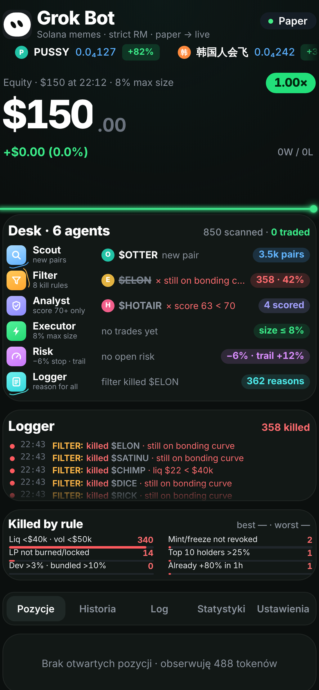

# Grok Bot · paper trading memecoinów na Solanie

Bot, który **na prawdziwych danych rynkowych** wyszukuje nowe memecoiny na Solanie, przepuszcza je przez 6 agentów (Scout → Filter → Analyst → Executor → Risk → Logger) i **handluje wyłącznie na papierze**: nie ma portfela, kluczy ani podpisywania transakcji. Panel to PWA, którą dodajesz do ekranu głównego iPhone'a. Działa na serwerze 24/7, a telefon jest tylko podglądem.

```
Scout ──► Filter ──► Analyst ──► Executor ──► Risk ──► (zamknięcie)
 nowe pary  8 reguł    score 0–100   8% equity    −6% stop
 GT + DS    + "pumped"  ≥ 70 kupuje   max 3 poz.   trail od +12%
                                                    time stop 45 min
                    Logger: każda decyzja z powodem → SQLite + panel (SSE)
```

> To narzędzie badawcze. Wyniki paper tradingu nie gwarantują wyników na prawdziwych pieniądzach.

<p align="center"></p>

---

## 1. Szybki start (lokalnie)

Wymagania: **Node.js 20+** (testowane na 22).

```bash
git clone <repo> grok-bot && cd grok-bot
npm install
cp .env.example .env        # uzupełnij DASHBOARD_PASSWORD (lokalnie może zostać puste)
npm run dev                 # albo: npm run build && npm start
```

Otwórz `http://localhost:8080`. Po kilku sekundach Scout zacznie pokazywać nowe pary, a Filter pierwsze odrzucenia.

| Komenda | Co robi |
|---|---|
| `npm run dev` | serwer z przeładowaniem (tsx) |
| `npm run build` / `npm start` | kompilacja do `dist/` i start produkcyjny |
| `npm test` | testy jednostkowe (vitest) na nagranych prawdziwych odpowiedziach API |
| `npm run replay` | odtwarza nagrane dane rynkowe z innymi ustawieniami (rozdz. 7) |
| `npm run stats` | statystyki bieżącej i poprzednich sesji z SQLite |
| `npm run record:fixtures` | nagrywa świeże odpowiedzi API do `test/fixtures` |
| `npm run icons` | generuje ikony PWA z `public/logo.svg` (wymaga Playwright) |

> Za korporacyjnym proxy Node'owy `fetch` nie czyta `HTTPS_PROXY`. Uruchom wtedy z `NODE_USE_ENV_PROXY=1` (Node ≥ 22.21).

---

## 2. Źródła danych (darmowe, prawdziwe)

Endpointy sprawdziłem w dokumentacji i wywołaniami na żywo 2026‑11‑08.

| Agent | Źródło | Endpoint | Limit / jak go szanujemy |
|---|---|---|---|
| Scout | GeckoTerminal | `GET /api/v2/networks/solana/new_pools?include=base_token,quote_token` | ~30/min → co 8 s, strona 2 max raz na 30 s, backoff na 429 (Retry‑After) |
| Scout | DexScreener | `GET /token-profiles/latest/v1`, `GET /token-boosts/latest/v1` (tylko `chainId=solana`) | 60/min → co 15 s |
| Filter / Risk | DexScreener | `GET /tokens/v1/solana/{do 30 adresów}` | 300/min → limiter ~270/min, priorytet dla otwartych pozycji |
| Filter | RugCheck | `GET /v1/tokens/{mint}/report` | cache 60 s na mint, kolejka 2 req/s, backoff na 429 |
| Analyst | GeckoTerminal | `GET /api/v2/networks/solana/pools/multi/{pary}` (unikalni kupujący) | wspólny limiter GT |
| Executor / Risk | Jupiter Swap API v2 | `GET https://api.jup.ag/swap/v2/order?inputMint&outputMint&amount` **bez `taker`** | z kluczem `x-api-key` 1 req/s, bez klucza 0,5 req/s |

**Wypełnienia na papierze.** Wejście (SOL → token) i wyjście (token → SOL) liczę z `outAmount` prawdziwego kwotowania Jupitera. Bez parametru `taker` Jupiter zwraca tylko kwotowanie, a `transaction` ma wartość `null`, więc nie ma czego podpisać. Platform fee Jupitera jest już odjęte w `outAmount`. Do tego doliczam priority fee (domyślnie 0,0001 SOL) oraz opłaty sieciowe, jeśli API je zwróci.
Gdy Jupiter nie odpowiada, wypełnienie jest **symulowane**: cena z DexScreener, price impact z modelu constant‑product (`size / (płynność/2 + size)`), 0,3% fee i priority fee. Źródło każdego wypełnienia (`jupiter/metis`, `jupiter/jupiterz`, `sim/sim-cpmm`) widać w historii transakcji.

---

## 3. Pipeline: 6 agentów

### Scout
Zbiera nowe pary z GeckoTerminal i DexScreener (profile + boosty), deduplikuje i liczy `scanned` (unikalne tokeny) oraz `pairs` (unikalne pary).

### Filter: 8 reguł + „already pumped”
Każde odrzucenie trafia do Loggera z powodem, a licznik reguły rośnie.

| # | Reguła | Domyślnie | Dane |
|---|---|---|---|
| 1 | Płynność | < $40k → kill | DexScreener `liquidity.usd` |
| 2 | Wolumen | 1h < $50k → kill (próg i okno konfigurowalne) | `volume.h1` |
| 3 | Mint authority | nieodebrane → kill | RugCheck `mintAuthority` |
| 4 | Freeze authority | nieodebrane → kill | RugCheck `freezeAuthority` |
| 5 | LP | spalone/zablokowane < 90% → kill | `markets[].lp.lpLockedPct`, **ważone płynnością** (pusty pool za $3 nie psuje wyniku) |
| 6 | Top 10 holderów | > 25% → kill | `topHolders[]` **bez** LP, pooli AMM i lockerów (`markets[]`, `knownAccounts` AMM/LOCKER) |
| 7 | Dev | `creatorBalance / supply` > 3% → kill | RugCheck |
| 8 | Bundled launch | > 10% → kill | max(holderzy `insider=true`, `insiderNetworks[].currentHolding / supply`, % z ryzyk „bundle”/„insider”) |
| + | Already pumped | `priceChange.h1` > 80% → kill | DexScreener |

**Okno obserwacji.** Świeża para z GeckoTerminal ma zwykle kilka tysięcy dolarów płynności. Zamiast od razu ją zabijać, Filter daje jej `FILTER_WATCH_WINDOW_MIN` (20 min) na „dorośnięcie” do progów płynności i wolumenu, sprawdzając ją co ~8 s. Pary starsze niż 2 h nie dostają okna. Reguły RugCheck i „+80%” zabijają od razu. Dzięki temu RugCheck jest pytany tylko o tokeny, które przeszły rynek.

### Analyst: score 0–100
Liczy wynik tylko dla tokenów, które przeszły Filter. Każda składowa ma wartość 0..1, a wynik to średnia ważona × 100. Wagi ustawiasz w panelu (Ustawienia):

| Składowa | Waga | Idea |
|---|---|---|
| momentum | 20 | m5 i h1 na plusie, ale bez paraboli (m5 > 25% jest karane) |
| buys/sells | 15 | najlepiej 1,2–2,5×, zbyt jednostronnie oznacza podejrzenie botów |
| wzrost wolumenu | 15 | wolumen z ostatnich 5 min przeskalowany względem h1 |
| płynność/FDV | 15 | ≥ 0,25 to pełne punkty |
| wiek pary | 10 | sweet spot 10–120 min |
| unikalni kupujący | 10 | GeckoTerminal `transactions.h1.buyers` |
| RugCheck | 15 | **`100 − score_normalised`**: w RugCheck to wynik *ryzyka* (1 = czysto, 81 = token twórcy z historią rugów) |

Kupuje tylko przy score ≥ 70. W przeciwnym razie loguje `killed $X · score 54 < 70`.

### Executor
Pozycja to maks. 8% equity, ale nie więcej niż wolna gotówka. Domyślnie maks. 3 otwarte pozycje i cooldown 30 min na token. Sloty i gotówka są rezerwowane na czas kwotowania, więc równoległe sygnały nie przekroczą limitu. Wejście liczone jest po kwotowaniu Jupitera. Kwotowanie z impactem > 15% albo > 25% powyżej ceny rynkowej jest odrzucane.

### Risk
Monitoruje ceny otwartych pozycji co 2,5 s. Stop loss to −6% od ceny wejścia. Trailing stop uzbraja się, gdy szczyt przekroczy +12%, i zamyka 6% pod szczytem. Time stop (45 min) działa tylko wtedy, gdy trailing nie jest uzbrojony (`0` go wyłącza). Wyjście zawsze idzie po prawdziwym kwotowaniu token → SOL. Brak trasy przez 10 min oznacza spisanie pozycji na zero.

### Logger
Zapisuje każdą decyzję (kill, score, buy, sell, skip) z czasem i powodem w SQLite i wysyła ją na żywo do panelu. Liczniki: „X killed”, „Y reasons”.

---

## 4. Panel (PWA)

Układ odwzorowuje screenshot 1:1: nagłówek, ticker z prawdziwymi tokenami, equity ze świecącą linią, „Desk · 6 agents”, „Logger”, „Killed by rule”. Pod spodem są zakładki:

- **Pozycje**: PnL na żywo, link do DexScreener, ręczne zamknięcie.
- **Historia**: zamknięte transakcje z fee i źródłem wypełnienia.
- **Log**: pełny dziennik decyzji z doczytywaniem starszych wpisów.
- **Statystyki**: winrate, średni zysk i strata, max drawdown, PnL po fee, opłaty, profit factor, kille per reguła, stan źródeł danych.
- **Ustawienia**: progi filtrów, wagi Analysta, parametry Risk, kapitał startowy, reset sesji, tryb LIVE.

Aktualizacje idą przez Server‑Sent Events. Po wybudzeniu telefonu (`visibilitychange`, `pageshow`, `online`) panel sam łączy się ponownie, a watchdog odnawia połączenie po 35 s ciszy. Service worker cache'uje tylko powłokę aplikacji, a dane (`/api/*`) zawsze idą z sieci.

---

## 5. Instalacja na iPhonie (ekran początkowy)

PWA i service worker wymagają **HTTPS**, więc najpierw wdróż bota (rozdz. 6).

1. Otwórz adres bota w **Safari** (np. `https://grok-bot-xyz.fly.dev`).
2. Zaloguj się hasłem z `DASHBOARD_PASSWORD`.
3. Stuknij **Udostępnij** (kwadrat ze strzałką w górę).
4. Przewiń w dół i wybierz **Do ekranu początkowego**.
5. Zostaw nazwę „Grok Bot” i stuknij **Dodaj**.

Ikona otwiera panel na pełnym ekranie, bez paska Safari (status bar `black-translucent`, marginesy `safe-area`). Sesja logowania trwa 30 dni.

---

## 6. Hosting 24/7

Bot musi chodzić na serwerze. Każda opcja potrzebuje **trwałego wolumenu** na `/data` (SQLite + nagrania) i zmiennej `DASHBOARD_PASSWORD`.

### Opcja A: Railway
1. Wypchnij repo na GitHub.
2. Na [railway.com](https://railway.com) wybierz **New Project → Deploy from GitHub repo** i wskaż repo. Railway sam wykryje `Dockerfile` (`railway.json`).
3. W serwisie: **Variables** dodaj `DASHBOARD_PASSWORD` (długie hasło), opcjonalnie `JUP_API_KEY` i inne z `.env.example`.
4. **Settings → Volumes → Add Volume**, mount path: `/data`.
5. **Settings → Networking → Generate Domain**. Dostaniesz adres `https://…up.railway.app` z HTTPS.
6. Otwórz adres na iPhonie i wykonaj kroki z rozdziału 5.

### Opcja B: Fly.io
```bash
brew install flyctl            # lub: curl -L https://fly.io/install.sh | sh
fly auth login
# w fly.toml zmień "app" na własną unikalną nazwę (i region, jeśli chcesz)
fly launch --no-deploy --copy-config
fly volumes create grokbot_data --size 1 --region fra
fly secrets set DASHBOARD_PASSWORD='dlugie-haslo' JUP_API_KEY='opcjonalnie'
fly deploy
fly open
```
`fly.toml` wyłącza usypianie maszyny (`auto_stop_machines = "off"`, `min_machines_running = 1`), bo bot ma działać non stop. HTTPS jest automatyczny (`https://<app>.fly.dev`).

### Opcja C: VPS + Caddy (automatyczny HTTPS)
Potrzebujesz VPS z Dockerem i domeny z rekordem **A** wskazującym na IP serwera.
```bash
git clone <repo> grok-bot && cd grok-bot
cp .env.example .env
nano .env        # DASHBOARD_PASSWORD=..., DOMAIN=bot.twojadomena.pl
docker compose up -d --build
docker compose logs -f bot
```
Caddy sam pobierze certyfikat Let's Encrypt. SSE przechodzi bez buforowania (`flush_interval -1`). Aktualizacja: `git pull && docker compose up -d --build`.

---

## 7. Testy, replay i statystyki

**Testy** (`npm test`) działają na **nagranych prawdziwych odpowiedziach** z `test/fixtures`: raportach RugCheck tokenów, które faktycznie łamią każdą regułę, parach DexScreener, nowych poolach GeckoTerminal, kwotowaniach Jupitera i prawdziwych seriach cen (np. krach NVIDIH o 63% do testu stop lossa). Obejmują reguły filtra, risk manager, Analysta, wypełnienia, sizing, pełny przepływ silnika i codec nagrań.

**Nagrywanie.** Przy `RECORD=true` bot zapisuje znormalizowane dane, które widział, do `data/recordings/rec-*.jsonl.gz`. Format jest kompaktowy: numeryczne ID mintów i tylko zmienione snapshoty, co daje ~30–40 MB na dobę (zmierzone na żywo). Najstarsze pliki są kasowane powyżej `RECORD_MAX_MB`.

**Replay** odtwarza nagrania przez ten sam silnik z wirtualnym zegarem:
```bash
npm run replay                                                   # bieżące ustawienia
npm run replay -- --set filter.minLiquidityUsd=25000 --set analyst.minScore=65
npm run replay -- --grid filter.minLiquidityUsd=20000,40000,60000 --grid analyst.minScore=60,70
npm run replay -- data/recordings/rec-2026-11-08-222238.jsonl.gz
```
Wynik to statystyki każdego wariantu i tabela porównawcza (kill%, scored, trades, winrate, PnL po fee, max DD, kille per reguła). Na krótkich nagraniach (krótszych niż 20-minutowe okno obserwacji) dodaj `--set filter.watchWindowMin=2`, inaczej mało który token zdąży dostać werdykt. Ograniczenia, które warto znać:
- Przy **luzowaniu** progów płynności/wolumenu część tokenów nie ma raportu RugCheck (bot na żywo go nie pobrał). Replay pokazuje je jako `no data`. Zaostrzanie progów działa w pełni.
- Wypełnienia w replay są symulowane (constant‑product).
- Pozycje otwarte tylko w replay mają rzadsze ceny niż pętla Risk na żywo (2,5 s), więc luki cenowe mogą wyjść większe.

**Statystyki na koniec sesji**: winrate, średni zysk/strata, max drawdown, PnL po fee (i brutto), opłaty, profit factor, powody wyjść, kille per reguła. Są widoczne w zakładce Statystyki, w `npm run stats`, w logu przy zatrzymaniu serwera (SIGTERM/SIGINT) i zapisywane w tabeli `sessions` przy resecie.

---

## 8. Tryb LIVE (zaślepka)

Domyślnie wyłączony i **niepotrzebny do działania aplikacji**. Wymaga dwóch potwierdzeń:
1. W `.env`: `TRADING_MODE=live` **i** `LIVE_CONFIRM=I_UNDERSTAND_REAL_MONEY`.
2. W panelu: Ustawienia → „Uzbrój LIVE” → okno potwierdzenia, a potem wpisanie `LIVE`.

Nawet po uzbrojeniu Executor tylko **loguje**, co by kupił, i dalej handluje na papierze. Podpisywania transakcji nie zaimplementowano celowo.

---

## 9. Konfiguracja

Wszystkie zmienne są opisane w `.env.example`. Progi filtrów, wagi, parametry Risk i kapitał można zmieniać w panelu. Zapisują się w SQLite i mają pierwszeństwo przed `.env`. Zmiana kapitału startowego działa od następnego resetu sesji.

## 10. Struktura

```
src/
  agents/      filter.ts · analyst.ts · executor.ts · risk.ts   (czyste funkcje, testowane)
  sources/     geckoterminal.ts · dexscreener.ts · rugcheck.ts · jupiter.ts
  engine.ts    stan, przepływ tokenów, pozycje, liczniki (te same I/O live i replay)
  runner.ts    pętle live (scout, rynek, risk, ticker, housekeeping)
  services.ts  RugCheck/GT/Jupiter + fallback sim
  server.ts    Fastify: API, SSE, login, pliki statyczne
  db.ts        SQLite (better-sqlite3, WAL)
  recorder.ts · recording.ts · replay.ts · stats.ts
public/        index.html (UI), sw.js, manifest.webmanifest, ikony, font Inter
test/          vitest + fixtures z prawdziwych odpowiedzi API
```

## 11. Bezpieczeństwo
- `DASHBOARD_PASSWORD` jest wymagane w produkcji (bez niego serwer nie wystartuje). Logowanie ma limit 10 prób na 15 min na IP, a ciasteczko jest `HttpOnly`, `SameSite=Lax` i `Secure` za HTTPS.
- Bot nie przechowuje żadnych kluczy prywatnych. Jedyny sekret to opcjonalny klucz API Jupitera.
